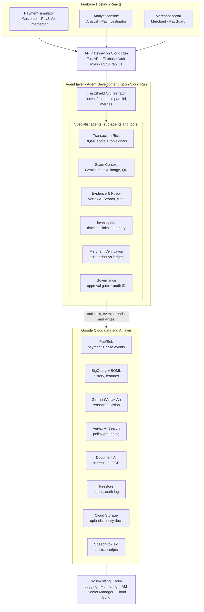
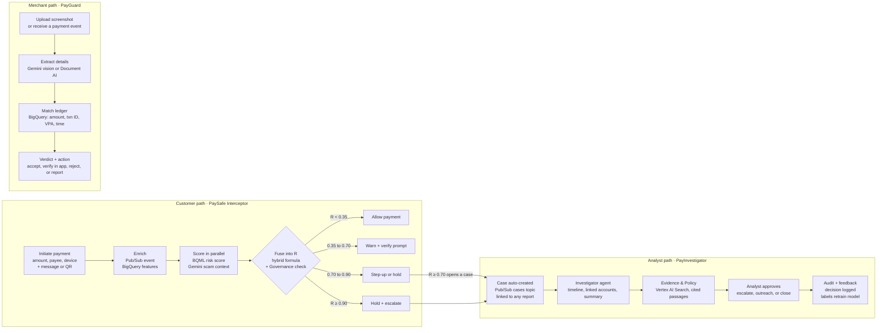
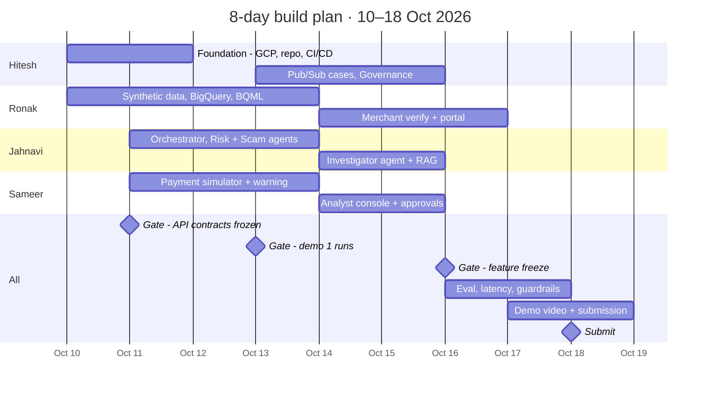

# Google Pay TrustShield — PRD & Architecture

Oct 10, 2026 · Jahnavi · Google Cloud AI Builder Cup, BFSI track · Submission deadline: 18 Oct 2026

## 1. Overview

TrustShield is an agentic safety layer for UPI that catches **authorized payments made under manipulation**. These are the scams that pass PIN and device checks because the victim approves them. It is our entry for the Google Cloud AI Builder Cup, BFSI track (Intelligent Risk, Fraud & Financial Experiences).

**Problem.** Today's fraud stacks score transactions well but rarely connect the payment to the message, call or QR code that induced it. Analysts stitch evidence together by hand across systems. Small merchants have no way to tell a fake payment screenshot from a settled payment.

**Solution.** One multi-agent platform with three modules on a shared risk and evidence core:

| Module | User | Job |
| --- | --- | --- |
| PaySafe Interceptor | Customer | Warns before a risky payment completes, in plain, non-accusatory language |
| PayInvestigator | Fraud analyst | Turns a flagged payment into an evidence-backed case with a recommended action |
| PayGuard | Merchant | Verifies payment screenshots, QR codes and collect requests against the ledger |

**Positioning.** A complementary intelligence service on synthetic data. It is not a replacement for Google Pay's payment or authentication systems.

## 2. Goals, non-goals and success metrics

**Goals**

1. Interrupt manipulated payments before completion with a contextual, explainable warning.
2. Cut analyst case-preparation time by auto-building the timeline, relationships, policy evidence and a recommendation.
3. Give merchants a one-step authenticity check for screenshots, QR codes and collect requests.
4. Make every recommendation grounded and auditable, with human approval for high-impact actions.

**Non-goals (hackathon)**

- Integrating with real Google Pay, NPCI or bank rails. Everything runs on synthetic data.
- Replacing UPI PIN, device binding or Google Pay's existing fraud models.
- Production-grade model training. A credible, explainable scorer is enough.
- Real call interception. Call transcripts are uploaded, not tapped.

**Success metrics (prototype targets, from the idea doc)**

| Metric | Target |
| --- | --- |
| Fraud detection recall, synthetic high-risk cases | 85–95% |
| False-positive reduction via contextual verification | 25–40% |
| Investigation preparation time | 50–70% reduction |
| Signals shown per customer warning | Top 3–5, each explained |
| Merchant screenshot-fraud detection | ≥ 90% on synthetic cases |
| Risk API latency | < 2 s average |
| Human approval on high-impact actions | 100% |

## 3. Personas and user stories

| Persona | Need | Key user stories | Priority |
| --- | --- | --- | --- |
| Customer (UPI payer) | Not be tricked into paying | As a customer, I see why a payment looks risky before I confirm it. I can paste or upload the message, QR or call transcript that asked me to pay. I can cancel, verify the recipient, or report in one tap. | P0 |
| Fraud analyst | Close cases faster and consistently | As an analyst, I open a flagged payment and see the timeline, top signals, linked accounts and cited policy. I can ask "Why was this flagged?" and get a grounded answer. I approve or reject escalation, and my decision is logged. | P0 |
| Merchant / small business | Not hand over goods for a fake payment | As a merchant, I upload a payment screenshot and get Verified / Pending / Inconsistent / Suspicious with one recommended action. I am warned about suspicious collect requests and altered QR codes. | P0 (screenshot), P1 (QR, collect, refund abuse) |
| Risk / compliance admin | Tune and govern the system | As an admin, I set risk thresholds per organization and review the audit trail for any decision. | P1 |

## 4. Functional requirements

**Functional requirements**

| ID | Requirement | Module | Priority |
| --- | --- | --- | --- |
| FR-1 | Accept a simulated UPI payment and return allow / warn / step-up / hold within the latency SLO | PaySafe | P0 |
| FR-2 | Compute behavioral features (amount deviation, beneficiary age, device, location, velocity) from history | Core | P0 |
| FR-3 | Classify uploaded text, screenshot, QR or transcript for scam patterns (urgency, fake KYC, fake refund, "receive money first") | PaySafe | P0 |
| FR-4 | Fuse signals into a score R using the hybrid formula; thresholds configurable per org | Core | P0 |
| FR-5 | Show the top 3–5 signals in plain, non-accusatory language with safe actions | PaySafe | P0 |
| FR-6 | Auto-create a case for R ≥ 0.70 and link any customer report to it | PayInvestigator | P0 |
| FR-7 | Case view: timeline, linked accounts/devices/VPAs, cited policy, recommendation, missing evidence | PayInvestigator | P0 |
| FR-8 | Analyst Q&A over the case, grounded in Vertex AI Search with citations | PayInvestigator | P0 |
| FR-9 | Human approval before any hold, restriction or escalation; decision written to audit log | Governance | P0 |
| FR-10 | Extract amount, UTR / transaction ID, VPA and time from a screenshot and match against the merchant ledger | PayGuard | P0 |
| FR-11 | Flag suspicious collect requests, low-value probing, QR tampering and refund abuse | PayGuard | P1 |
| FR-12 | Analyst labels feed back into the training table | Core | P1 |

**Agent roster**

| Agent | Inputs | Outputs | Built with |
| --- | --- | --- | --- |
| Orchestrator | API request, session state | Routes to sub-agents, merges results | ADK root agent on Cloud Run |
| Transaction Risk | Payment + BigQuery features | Score, category, top signals | BigQuery ML / Vertex AI model + rules |
| Scam Context | Text, image, QR, transcript | Scam probability, pattern, manipulation cues | Gemini multimodal, Speech-to-Text |
| Evidence & Policy | Risk category, metadata | Policy passages, checklist, source refs | Vertex AI Search (RAG) |
| Investigator | Flagged txn, related history, policy | Case summary, timeline, relationships, action | Gemini + BigQuery tools |
| Merchant Verification | Screenshot, ledger, QR, refunds | Payment status, risk, explanation, action | Document AI / Gemini vision + BigQuery |
| Governance | Proposed action, evidence, score | Permit / needs approval, audit ID, reason | Deterministic rules + Gemini check |

## 5. Architecture



The three apps call one gateway. The orchestrator fans out to specialist agents in parallel, and every high-impact action passes the Governance agent before it is executed or logged.

## 6. End-to-end workflow



The risk score R decides the customer outcome. Anything at 0.70 or above opens a case that only a human can escalate, and every decision is logged and fed back as a training label.

**Risk formula (from the idea doc).** A = amount deviation, B = beneficiary risk, D = device anomaly, L = location anomaly, V = velocity, S = scam-context probability, N = mule-network risk:

```latex
R = \sigma(w_1 A + w_2 B + w_3 D + w_4 L + w_5 V + w_6 S + w_7 N)
```

## 7. Tech stack

The MVP column is the smallest set that still shows every Google Cloud capability judges will look for. The stretch column is what to add if time allows.

| Layer | MVP pick | Stretch | Role |
| --- | --- | --- | --- |
| Frontend | React (Vite) on Firebase Hosting, one app with 3 routes | Flutter mobile shell for the payer | Payment simulator, analyst console, merchant portal |
| Auth | Firebase Auth (demo roles: customer, analyst, merchant) | IAP for analyst console | Role-based access |
| API + agents | Python FastAPI + Agent Development Kit (ADK) on Cloud Run | Vertex AI Agent Engine for hosted agents | Gateway, orchestrator, sub-agents |
| Events | Pub/Sub topics: `payments`, `alerts`, `cases`, `reports` | Eventarc triggers | Decouple scoring from case creation |
| Data | BigQuery: transactions, beneficiaries, devices, labels, merchant ledger | BigQuery graph-style link queries for mule rings | History, features, analytics |
| Features | BigQuery SQL views (pre-computed per user) | Dataflow streaming features | Amount deviation, velocity, beneficiary age |
| Risk model | BigQuery ML boosted tree + rule weights in the R formula | Vertex AI AutoML tabular + Model Monitoring | Score and top signals |
| Reasoning | Gemini on Vertex AI (Flash for live path, Pro for investigator) | Gemini Live for call coaching | Scam detection, explanations, case summaries |
| Multimodal | Gemini vision for screenshots and QR; Document AI OCR as fallback | Speech-to-Text for audio uploads | Extract claimed payment details |
| Grounding | Vertex AI Search data store over policy PDFs and playbooks | Add historical case corpus | Cited policy evidence |
| App state | Firestore: cases, approvals, audit log, configs | Cloud SQL / AlloyDB | Live dashboards, approvals |
| Storage | Cloud Storage: uploads, policy docs, synthetic datasets | — | Evidence artifacts |
| Ops | Cloud Logging, Cloud Monitoring, Cloud Trace | Looker Studio on BigQuery | Latency, errors, audit events |
| Security | IAM service accounts per service, Secret Manager | VPC Service Controls, DLP API for PII redaction | Least privilege, data minimization |
| Delivery | GitHub + Cloud Build → Artifact Registry → Cloud Run | Terraform | Repeatable deploys |

## 8. Non-functional requirements and SLOs

| Area | SLO / requirement | How we meet it |
| --- | --- | --- |
| Latency, payment risk API | p50 < 800 ms, p95 < 2 s (text-only context) | Precomputed BigQuery features cached in Firestore; Gemini Flash; parallel sub-agent calls |
| Latency, image / audio context | p95 < 5 s | Async: show a "checking" state, then the warning |
| Latency, case summary | < 10 s | Generated off the hot path when the case is created |
| Availability (demo) | 99% during judging window | Cloud Run min-instances = 1 on gateway and orchestrator |
| Explainability | Every decision returns top signals + evidence IDs | Governance agent rejects outputs without evidence |
| Grounding | 100% of policy claims cite a Vertex AI Search source | Answer only from retrieved passages; else "not in policy" |
| Human oversight | 100% of hold / restrict / escalate actions need analyst approval | Governance gate + approval record in Firestore |
| Auditability | Every recommendation, approval and action has an audit ID | Append-only audit collection + Cloud Logging |
| Privacy | Synthetic data only; never ask for PIN, OTP, password or full card number | Prompt guardrails, output filter, DLP redaction (stretch) |
| Tone | Customer warnings are non-accusatory and actionable | Prompt templates + an eval set of warnings |
| Configurability | Risk thresholds editable per org without redeploy | Thresholds stored in Firestore config |

## 9. Hackathon build plan

**MVP cut.** Ship the three demo stories end to end on synthetic data: the ₹85,000 "account will be blocked" scam, the analyst approving escalation, and the fake ₹12,000 screenshot. Everything else is stretch.

**Workstreams and owners** (suggested split — swap freely)

| Workstream | Owner | Owns | First deliverable |
| --- | --- | --- | --- |
| Platform & governance | Hitesh | Cloud Run, Pub/Sub, Firestore, IAM, Governance agent, audit log, CI/CD | One-command deploy of all services |
| Data & model + merchant | Ronak | Synthetic data generator, BigQuery schema, feature views, BQML model, R formula; later the merchant ledger match | 50k synthetic txns with labelled scam scenarios |
| Frontend | Sameer | Payment simulator, analyst console, merchant portal | Clickable payment flow with warning sheet |
| Agents & prompts | Jahnavi | ADK orchestrator, Risk / Scam / Investigator / Evidence agents, prompt templates, Vertex AI Search data store, eval set | `/payment-risk/evaluate` returning a full decision |

**Phases**

Submission is due 18 Oct 2026, eight days from today. All four work in parallel from day one. Feature freeze on 16 Oct leaves two days for evaluation, the video and buffer.



**Gates.** Each gate is a working demo, checked at that evening's standup. A missed gate cuts P1 scope, never the freeze date.

| Date | Gate: done means | Owner |
| --- | --- | --- |
| Sun 11 Oct 2026 | Hello-world deployed to Cloud Run via CI; API contracts and BigQuery schema frozen | Hitesh |
| Tue 13 Oct 2026 | Demo 1: the ₹85,000 "account blocked" payment gets a warning with its top signals | Jahnavi, Sameer, Ronak |
| Thu 15 Oct 2026 | Demo 2: case auto-created, grounded Q&A answers, analyst approval logged with an audit ID | Hitesh, Jahnavi, Sameer |
| Fri 16 Oct 2026 | Demo 3: fake ₹12,000 screenshot flagged against the ledger; feature freeze | Ronak, Sameer |
| Sat 17 Oct 2026 | Eval set run against the section 2 targets; latency tuned; video recorded | All |
| Sun 18 Oct 2026 | Submission doc and video submitted, aiming for midday | All |

**Team rhythm:** a 15-minute standup each morning, a gate check each evening, and one shared demo environment that is never broken overnight.

**Submission deck checklist.** This maps each slide of the AI Builder Cup template to its source and owner. Most slides reuse this PRD, so the deck is a 1-day job, not a 3-day one.

| Template slide | Source in this PRD | Owner | Due |
| --- | --- | --- | --- |
| 1. Team details, problem statement | Section 1; BFSI track | Jahnavi | 14 Oct |
| 3–5. Brief, opportunities / USP, features | Sections 1, 2, 4 | Jahnavi | 14 Oct |
| 6. Process flow diagram | Section 6 workflow diagram | Hitesh | 14 Oct |
| 7. Wireframes (optional) | Screens from the frontend | Sameer | 16 Oct |
| 8–9. Architecture, technologies | Sections 5 and 7 | Hitesh | 14 Oct |
| 10. Implementation cost (optional) | GCP pricing calculator for the MVP stack | Hitesh | 17 Oct |
| 11. Prototype snapshots | Screenshots of the three demo stories | Sameer | 17 Oct |
| 12. Performance / benchmarking | Eval run vs section 2 targets; p50/p95 latency from Cloud Monitoring | Ronak, Jahnavi | 17 Oct |
| 13. Future development | Stretch column of section 7 | Jahnavi | 17 Oct |
| 14. Links: public GitHub repo | Repo public from day one, README + architecture | Hitesh | 11 Oct |
| 14. Links: 3-minute demo video | Script from the three demo stories | All, edited by Sameer | 17 Oct |
| 14. Links: final product link | Firebase Hosting URL, kept live through judging | Hitesh | 18 Oct |

The template asks for a .pptx download, not edit access: export the final deck as .pptx before submitting.

**Getting started this week**

- [ ] Create the GCP project, enable Vertex AI, BigQuery, Pub/Sub, Cloud Run, Firestore, Document AI, Discovery Engine APIs
- [ ] Set up a monorepo: `/web`, `/services/gateway`, `/services/agents`, `/data`, `/infra`
- [ ] Write the synthetic data generator (normal users + 5 scam archetypes + mule rings + merchant ledger)
- [ ] Collect 10–15 public safety / policy documents (e.g. RBI and NPCI customer-safety guidance) into a GCS bucket
- [ ] Freeze the API contracts from the idea doc (`/payment-risk/evaluate`, `/merchant/payment-verify`) so frontend and agents work in parallel
- [ ] Draft the demo script and the eval set before building, so every feature maps to a demo beat

## 10. Risks and open questions

| Risk | Impact | Mitigation |
| --- | --- | --- |
| Scope: three modules + six agents is a lot for a hackathon | Nothing finished well | Build the three demo stories first; P1 items only after all three run end to end |
| Gemini latency on the live payment path | Misses the < 2 s SLO | Flash model, short prompts, text-first; images analysed async |
| Synthetic data looks too easy | Recall numbers lack credibility | Include hard negatives (big but legitimate payments, new but genuine payees) |
| Hallucinated policy citations | Breaks the "grounded" pitch | Governance agent blocks any claim without a retrieved source |
| Using Google Pay branding in the demo UI | Could read as impersonating the real app | Label the UI clearly as a prototype simulator with synthetic data |

**Open questions**

- [ ] Judging format: live demo, video, or both? (Deadline set: 18 Oct 2026.)
- [ ] Confirm the suggested owner split in section 9.
- [ ] The idea doc's sample response returns `STEP_UP_VERIFICATION` at R = 0.93, but the threshold table says R ≥ 0.90 → hold and escalate. Which is intended?
- [ ] React or Flutter for the frontend?
- [ ] Which public policy documents will ground Vertex AI Search?
