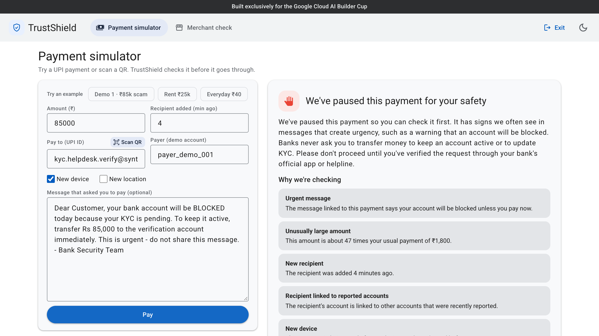
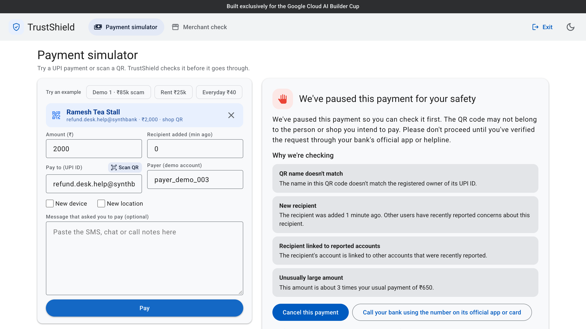
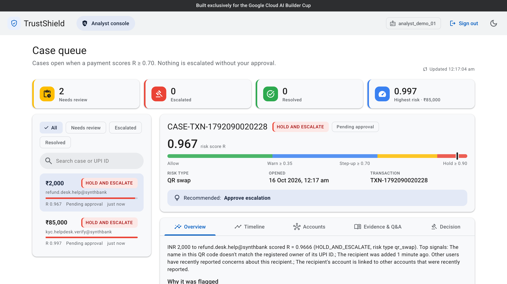
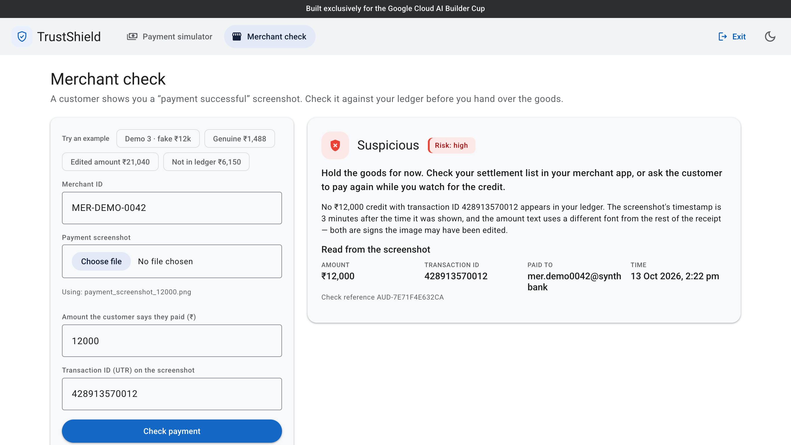
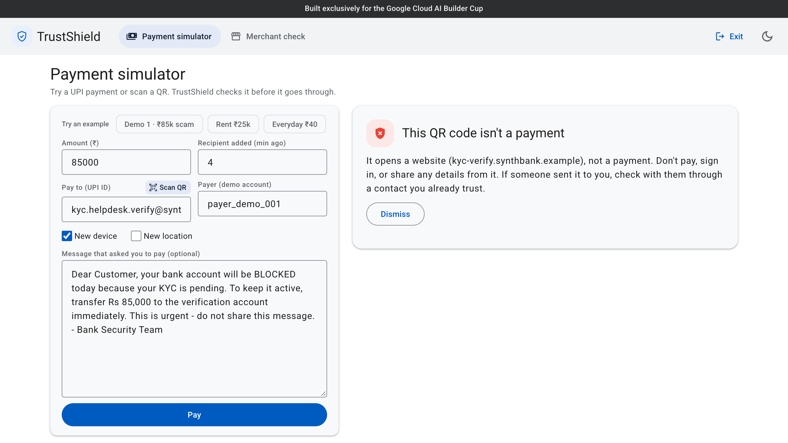
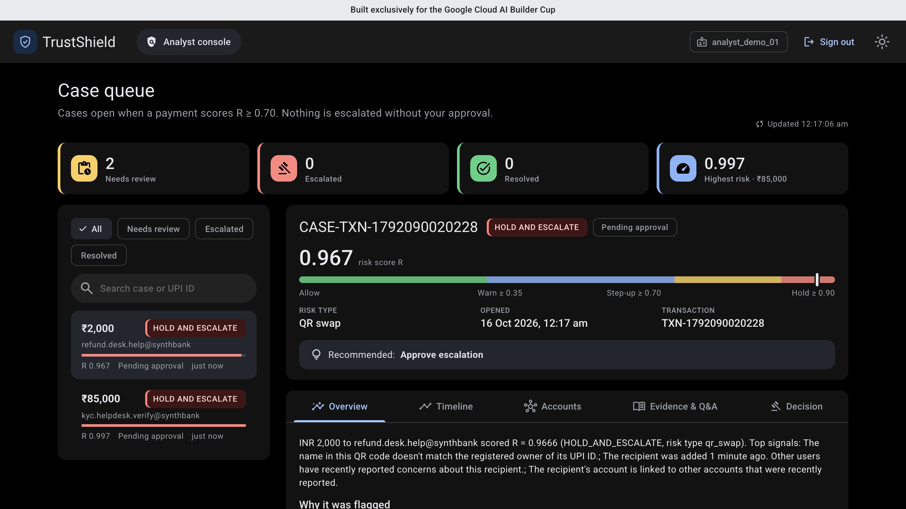
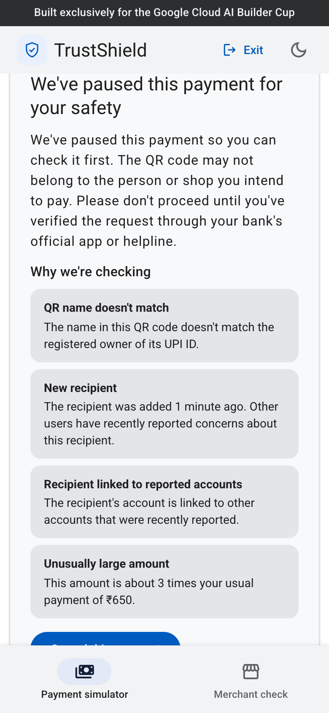
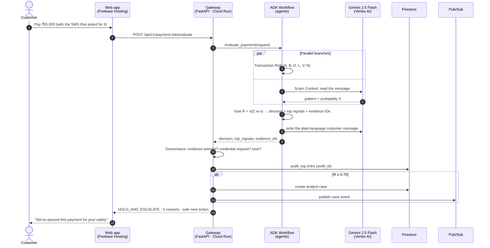
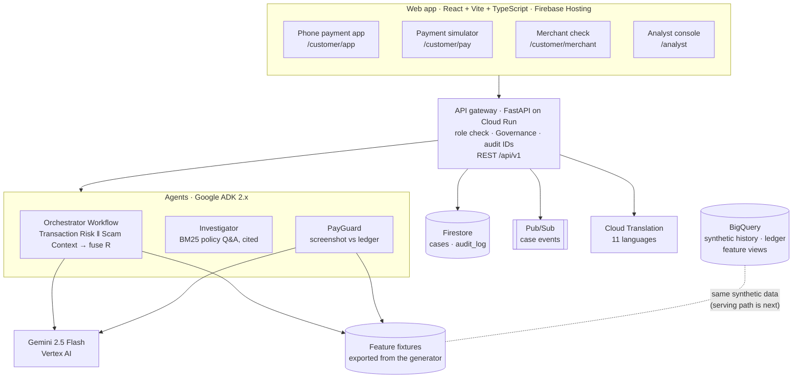

<div align="center">

# 🛡️ TrustShield

### The agentic safety layer that stops UPI scams people approve themselves — *before the money moves.*

[](#)
[](#)
[](https://qualified-sun-511214-t1.web.app)

[](#google-cloud-services)
[](#how-it-works)
[](#google-cloud-services)
[](#google-cloud-services)
[](#getting-started)
[](#getting-started)

**[▶️ Demo video](https://drive.google.com/file/d/1OT4J6upqnwNbr3Chm0TBQCN64D5_EHrK/view?usp=sharing)** ·
**[🎬 Walkthrough](https://drive.google.com/file/d/1CCKluiNd8kW6rEuYTRTZ5Socch0ivQac/view?usp=sharing)** ·
**[🌐 Live prototype](https://qualified-sun-511214-t1.web.app)** ·
**[⚙️ Live API](https://trustshield-gateway-hi3bby3bbq-el.a.run.app/docs)** ·
**[📘 Demo guide](docs/demo/DEMO_GUIDE.md)** ·
**[📄 PRD](Google_Pay_TrustShield_PRD.md)**

</div>

> [!IMPORTANT]
> **Prototype simulator, synthetic data only.** TrustShield is a hackathon entry for the Google Cloud AI Builder Cup.
> It is **not affiliated with Google Pay**, uses no real Google Pay data, identities or credentials, and does not
> imitate the Google Pay app. Every person, account, UPI ID, message and screenshot in this repo is synthetic.

<div align="center">
  
  <br/>
  <sub><b>Demo 1.</b> An "account will be BLOCKED" SMS, a payee added 4 minutes ago, a new device and 47× the usual amount.
  The PIN is correct and the phone is trusted — TrustShield pauses the payment anyway and explains why, in plain words.</sub>
</div>

---

## Submission links

| | Link | What you'll find |
|:---:|---|---|
| 🐙 | **GitHub repository (public)** — <https://github.com/jahnavig03/TrustShield> | README, architecture, tests and every service |
| ▶️ | **Demo video (3 minutes)** — [watch on Google Drive](https://drive.google.com/file/d/1OT4J6upqnwNbr3Chm0TBQCN64D5_EHrK/view?usp=sharing) | The three demo stories, end to end |
| 🎬 | **Project walkthrough video** — [watch on Google Drive](https://drive.google.com/file/d/1CCKluiNd8kW6rEuYTRTZ5Socch0ivQac/view?usp=sharing) | How TrustShield works, explained in detail |
| 🌐 | **Live prototype** — <https://qualified-sun-511214-t1.web.app> | Phone app, payment check, analyst and merchant views |
| ⚙️ | **Live API on Cloud Run** — <https://trustshield-gateway-hi3bby3bbq-el.a.run.app/docs> | Try every endpoint in the browser |

---

## Table of contents

- [Submission links](#submission-links)
- [The problem](#the-problem)
- [Our solution](#our-solution)
- [See it in action](#see-it-in-action)
- [How it works](#how-it-works)
- [Architecture](#architecture)
- [Google Cloud services](#google-cloud-services)
- [Results](#results)
- [Responsible AI and safety](#responsible-ai-and-safety)
- [Getting started](#getting-started)
- [API reference](#api-reference)
- [Deployment](#deployment)
- [Repository structure](#repository-structure)
- [Roadmap](#roadmap)
- [Team](#team)

---

## The problem

UPI scams no longer need to break anything. The victim is **talked into paying**: "your account will be blocked
today", a fake KYC update, a fake refund, "receive money first", a swapped QR sticker at a shop counter.
The PIN is correct, the device is trusted and the customer approves the payment themselves, so **every
conventional check passes**.

Fraud systems score the *transaction*, but rarely connect it to the *message, chat or QR code* that caused it.
Analysts get alerts without context, and shopkeepers are shown "payment successful" screenshots that were edited
in seconds.

## Our solution

TrustShield is a **multi-agent safety layer** that reads the payment *and* the manipulation behind it, fuses them
into one explainable risk score, and acts before the money moves — with a human in charge of every high-impact action.

<table>
<tr>
<th width="33%">🛡️ PaySafe Interceptor</th>
<th width="33%">🔎 PayInvestigator</th>
<th width="33%">🏪 PayGuard</th>
</tr>
<tr>
<td valign="top"><b>For the customer.</b> Scores every payment, including scanned QR codes, and returns
<code>ALLOW</code> · <code>WARN</code> · <code>STEP_UP</code> · <code>HOLD</code> with the top 3–5 reasons in plain,
non-accusatory language and a safe next step.</td>
<td valign="top"><b>For the fraud analyst.</b> Opens a case automatically when R ≥ 0.70 with the timeline, linked
accounts, cited policy and grounded Q&A. Nothing escalates until a human approves it, and every decision gets an audit ID.</td>
<td valign="top"><b>For the merchant.</b> Reads a "payment successful" screenshot and checks it against the
merchant's ledger: <code>verified</code> · <code>pending</code> · <code>inconsistent</code> ·
<code>not found</code> · <code>suspicious</code>.</td>
</tr>
</table>

**What makes it different**

- **Context, not just amounts.** Gemini reads the SMS or chat behind the payment (English and Hinglish) and that
  scam probability is one of seven fused signals — so a big but genuine rent payment goes through while a small
  "refund" scam is paused.
- **Explainable by design.** One transparent formula, every signal shown with its weighted contribution, every policy
  claim cited.
- **Human in the loop.** The agents recommend; the gateway's Governance module enforces approval, evidence and tone
  rules in code.
- **Built for India.** A phone payment app experience in **11 languages** through Cloud Translation, and Hinglish
  scam messages handled natively.

---

## See it in action

> [!TIP]
> **Try it live:** <https://qualified-sun-511214-t1.web.app> — start with **Customer → Phone payment app** for the
> real-life experience, then sign in as an analyst. Sign-ins and sample data are in the
> [demo guide](docs/demo/DEMO_GUIDE.md).

| | | |
|:---:|:---:|:---:|
|  |  |  |
| **Swapped QR sticker** — the name says "Ramesh Tea Stall", the UPI ID belongs to someone else. Paused. | **Case opens itself** — risk meter, recommended action, timeline, linked accounts, cited policy. | **Fake ₹12,000 screenshot** — not in the ledger, timestamp 3 min in the future, edited font. Suspicious. |
|  |  |  |
| **Not a payment** — a "KYC update" link QR is caught right on the device. | **Dark mode** and a responsive layout from phone to desktop. | **Mobile first** — the same checks on a phone screen. |

<details>
<summary><b>Three demos, three minutes</b> (the judging script)</summary>

| # | Module | Scenario | Outcome |
|---|---|---|---|
| 1 | PaySafe Interceptor | ₹85,000 to `kyc.helpdesk.verify@synthbank` after an "account will be BLOCKED… KYC" SMS, payee added 4 min ago, new device | **Paused**, R ≈ 0.997, five plain reasons |
| 1b | PaySafe Interceptor | Swapped QR sticker at a tea stall | **Paused**: "QR name doesn't match" |
| — | PaySafe Interceptor | ₹25,000 rent to a long-standing landlord | **Goes through** (a hard negative) |
| 2 | PayInvestigator | Open the ₹85,000 case → *"Why was this payment flagged?"* → approve escalation | Cited answer; decision recorded with `AUD-…` |
| 3 | PayGuard | A customer shows a ₹12,000 "payment successful" screenshot | **Suspicious / high** — "hold the goods" |

Full script, sign-ins and every sample input: [`docs/demo/DEMO_GUIDE.md`](docs/demo/DEMO_GUIDE.md).
</details>

---

## How it works

### One explainable risk score

Seven signals, each normalised to `[0, 1]`, are fused by a single transparent formula:

$$R = \sigma\left(b + w_A A + w_B B + w_D D + w_L L + w_V V + w_S S + w_N N\right)$$

| Signal | Meaning | Source |
|---|---|---|
| **A** | Amount deviation from the payer's usual payment | payer history |
| **B** | Beneficiary risk: new payee, reported flags | payee features |
| **D** | Device anomaly | session |
| **L** | Location anomaly | session |
| **V** | Velocity: payments in the last hour / day | payer history |
| **S** | Scam-context probability of the message or QR | **Gemini** (rules as fallback) |
| **N** | Mule-network risk: links to reported accounts | payee graph features |

Weights, bias and thresholds live in [`services/agents/config/risk.yaml`](services/agents/config/risk.yaml), never in code.

| R | Decision | What the customer sees |
|---|---|---|
| < 0.35 | `ALLOW` | Payment goes through |
| 0.35 – 0.70 | `WARN` | A pause with the reasons; they can continue |
| 0.70 – 0.90 | `STEP_UP_VERIFICATION` | Must confirm they verified the request; **a case opens** |
| ≥ 0.90 | `HOLD_AND_ESCALATE` | Payment paused; **a case opens** for an analyst |

### A payment, end to end



### Inside each module

<details>
<summary><b>PaySafe Interceptor</b> — the ADK Workflow</summary>

The orchestrator is a Google **Agent Development Kit 2.x graph `Workflow`**
([`orchestrator.py`](services/agents/src/trustshield_agents/orchestrator.py)):

```text
START → parse_request → (transaction_risk ‖ scam_context) → join_signals → fuse_decision
```

- `transaction_risk` computes A, B, D, L, V and N from payer and payee features.
- `scam_context` sends the message (or decoded QR) to **Gemini 2.5 Flash** for a scam pattern and probability,
  with deterministic keyword rules as a fallback if Gemini is slow or rate-limited.
- QR codes are decoded on the device; the name inside the QR is checked against the UPI ID's registered owner.
- `fuse_decision` applies the formula, picks the top 3–5 signals and attaches policy evidence IDs.
- Gemini then writes the customer message; a template writer is the fallback. Every message passes tone checks.
</details>

<details>
<summary><b>PayInvestigator</b> — grounded case work</summary>

- Cases open automatically for any decision with R ≥ 0.70, with a timeline, linked accounts and devices.
- **Grounded Q&A:** answers come only from a BM25 search over the synthetic policy corpus
  ([`investigator.py`](services/agents/src/trustshield_agents/investigator.py)). Every claim quotes a passage and
  cites its evidence ID; if nothing relevant is retrieved, the answer is exactly **"not covered by policy"**.
- **Human approval:** *Approve escalation*, *Customer outreach* or *Close case*, with a written reason, recorded under
  the analyst's ID with an audit ID.
</details>

<details>
<summary><b>PayGuard</b> — screenshot vs ledger</summary>

- **Gemini vision** reads the screenshot: amount, UTR, payee UPI ID, timestamp and tamper hints such as a mismatched font.
- The reading is matched against the merchant's ledger, with thresholds in
  [`config/merchant.yaml`](services/agents/config/merchant.yaml).
- Verdicts: `verified`, `pending`, `inconsistent` (it exists but details differ), `not_found_in_ledger` (careful
  wording: "a genuine payment can take a few minutes") and `suspicious`.
- Merchant text never says "fraud" or "scam" and never asks for credentials.
</details>

<details>
<summary><b>Phone payment app and languages</b></summary>

`/customer/app` is **SynthPay**, a simulated UPI app with TrustShield built in: an SMS notification arrives, the
customer taps Pay, and TrustShield decides before the PIN screen. The whole app — menus, the SMS, and TrustShield's
live warning and reasons — switches between **English, हिन्दी, বাংলা, తెలుగు, मराठी, தமிழ், ગુજરાતી, ಕನ್ನಡ, മലയാളം,
ਪੰਜਾਬੀ and ଓଡ଼ିଆ** through **Google Cloud Translation**. Names, amounts and UPI IDs are never translated. The PIN pad is
a dummy that sends nothing.
</details>

---

## Architecture



**Design choices**

- **Ports and adapters.** Every external dependency sits behind an interface (`ports/` + `adapters/`), so the same
  code runs in `TRUSTSHIELD_MODE=mock` (no credentials: deterministic rules, JSON fixtures, in-memory store) and
  `TRUSTSHIELD_MODE=gcp` (Gemini, Firestore, Pub/Sub, Cloud Translation).
- **One contract.** Pydantic v2 models in [`shared/contracts`](shared/contracts/CONTRACT.md) are the API source of
  truth; the web client is generated from the exported OpenAPI schema.
- **Governance in the gateway, not the agents.** Agents recommend; the gateway enforces and records.
- **Graceful degradation.** If Gemini is busy, scam context and customer text fall back to rules and templates, and
  the payment is still decided in time.

---

## Google Cloud services

| Service | What TrustShield uses it for | Status |
|---|---|---|
| **Gemini 2.5 Flash on Vertex AI** | Scam context in SMS and chat (English, Hinglish), plain-language customer messages, PayGuard screenshot reading | ✅ Live |
| **Agent Development Kit (ADK 2.x)** | Orchestrator as a graph `Workflow` with parallel branches | ✅ Live |
| **Cloud Run** (`asia-south1`) | The API gateway with the agents built in | ✅ Live |
| **Firestore** | Analyst cases and the `audit_log` collection | ✅ Live |
| **Pub/Sub** | Case events | ✅ Live |
| **Cloud Translation** | The phone app in 11 Indian languages | ✅ Live |
| **Firebase Hosting** | The React web app | ✅ Live |
| **Cloud Build + Artifact Registry** | `test → build → push → deploy → smoke` on every push to `main` | ✅ Live |
| **BigQuery** | Synthetic 90-day payment history, merchant ledger and payer/payee feature views, loaded in batch ([`data/`](data/README.md)) | 🟡 Built — live scoring reads fixtures exported from the same generator |
| **Vertex AI Search** | Managed policy retrieval | 🔜 Next — BM25 over the policy corpus today |

---

## Results

Measured on synthetic data with the evaluation runner in [`evals/`](evals/README.md). Full report:
[`evals/results/2026-10-13-gcp.md`](evals/results/2026-10-13-gcp.md).

<div align="center">

| 🎯 High-risk scams caught | 📉 Fewer false alarms than rules | ⚡ Mean risk-API latency | 🧾 Fake screenshots flagged |
|:---:|:---:|:---:|:---:|
| **12 / 12** | **88 %** | **0.77 s** | **19 / 19** |
| target 85–95 % | 8/10 → 1/10 legit payments · target 25–40 % | p95 1.08 s · target < 2 s | 0 false alarms on 11 genuine · target ≥ 90 % |

</div>

| Metric (PRD §2) | Target | Result |
|---|---|---|
| Fraud detection recall on high-risk payments (≥ WARN) | 85–95 % | ✅ **100 %** (12/12) |
| False-positive reduction vs context-free rules (hard negatives) | 25–40 % | ✅ **88 %** (TrustShield 1/10 vs baseline 8/10) |
| Signals shown per customer warning | top 3–5, each explained | ✅ **100 %** of non-ALLOW responses (13/13) |
| Risk API latency | < 2 s average | ✅ mean **773 ms** · p50 862 ms · p95 1080 ms |
| Human approval on high-impact actions | 100 % | ✅ **100 %** (12/12) STEP_UP/HOLD open a case; approval enforced by Governance |
| Merchant screenshot-fraud detection | ≥ 90 % | ✅ **19/19** fakes flagged, **0/11** false alarms |
| Tone violations in customer text | 0 | ✅ **0** of 80 responses |
| Responses carrying evidence IDs | 100 % | ✅ **100 %** (80/80) |

> [!NOTE]
> **How these were measured — and their limits.** Payment and message metrics come from 30 payment scenarios and
> 50 messages run with real Gemini on Vertex AI (`--mode gcp`). The baseline is a context-free rule set (amount ≥ 5×
> median, payee < 24 h old, or new device). The PayGuard figure comes from the merchant test suite over 30 synthetic
> screenshots with deterministic extraction (mock mode). These are small, synthetic sets built by the team; a
> 100-message held-out set ([`evals/heldout_messages.jsonl`](evals/heldout_messages.jsonl)) exists for the next run.

---

## Responsible AI and safety

Enforced in code and covered by tests in the gateway and agents suites:

| Rule | How it's enforced |
|---|---|
| 🧑‍⚖️ **Humans decide** | Hold, restrict and escalate require an analyst approval record. Agents only recommend. |
| 📎 **No evidence, no action** | Any decision without `evidence_ids` is blocked by Governance. |
| 🔐 **Never ask for credentials** | Customer text that asks for a PIN, OTP, password or full card number is **blocked**, not cleaned up. |
| 🧾 **Everything is audited** | Every decision gets an `audit_id` and is written to Firestore `audit_log`. |
| 📚 **Grounded answers only** | Every policy claim cites a retrieved passage; otherwise "not covered by policy". |
| 🤝 **Non-accusatory language** | Customer and merchant text never blames the user and always gives a safe next action (0 violations in evals). |
| 🧪 **Synthetic data only** | Seeded generators in [`data/`](data/README.md); no real people, accounts or Google Pay data. |
| 🏷️ **No brand imitation** | A pinned "Built exclusively for the Google Cloud AI Builder Cup" banner; no Google or Google Pay logos. |

---

## Getting started

Everything runs locally **without any Google Cloud credentials** (`TRUSTSHIELD_MODE=mock`).

**Prerequisites:** Python 3.11+, Node.js 24 LTS. Optional: Java 21+ and the Firebase CLI for the Firestore emulator.

```bash
git clone https://github.com/jahnavig03/TrustShield.git
cd TrustShield
cp .env.example .env            # TRUSTSHIELD_MODE=mock by default
```

**1 · Gateway (with the agents built in)** → <http://localhost:8000/docs>

```bash
cd services/gateway
python3 -m venv .venv && source .venv/bin/activate
pip install --prefer-binary -r requirements.txt -e ../../shared/contracts -e ../agents
uvicorn main:app --reload
```

**2 · Web app** → <http://localhost:5173>

```bash
cd web
npm install
npm run dev
```

<details>
<summary><b>Tests, evals and developer tools</b></summary>

```bash
# Tests — run inside each package (gateway, agents, shared/contracts, data) with its venv active
pytest
cd web && npm test && npm run lint

# Agents on their own
cd services/agents && python3 -m venv .venv && source .venv/bin/activate
pip install --prefer-binary -r requirements.txt -e ../../shared/contracts -e .
python -m trustshield_agents.risk demo     # risk engine on the ₹85,000 fixture
python -m trustshield_agents.demo1         # the full agent path
adk web adk_apps                           # ADK dev UI

# Evals → evals/results/<date>.md
python ../../evals/run_evals.py            # add --mode gcp for real Gemini

# Contract → OpenAPI (re-run after any model change), then regenerate the web client
cd shared/contracts && python scripts/export_openapi.py
cd web && npm run gen:api

# Synthetic data (seeded, reproducible) and the BigQuery batch load
cd data && python -m generator --help
bash bq/load.sh --dry-run                  # batch load only; --dry-run changes nothing
```

**Use real Google Cloud:** set `TRUSTSHIELD_MODE=gcp`, `GCP_PROJECT_ID`, `GCP_REGION` and `GEMINI_FAST_MODEL`, then
run `gcloud auth application-default login`.
</details>

---

## API reference

Base path `/api/v1`. The demo sends its role in an `X-Demo-Role` header (`customer`, `analyst` or `merchant`);
a missing header returns `401`, the wrong role `403`. Interactive docs: [`/docs`](https://trustshield-gateway-hi3bby3bbq-el.a.run.app/docs).

| Method | Path | Role | Purpose |
|---|---|---|---|
| `POST` | `/api/v1/payment-risk/evaluate` | customer | Score a payment → decision, top signals, customer message, audit ID |
| `POST` | `/api/v1/merchant/payment-verify` | merchant | Check a payment screenshot against the ledger |
| `GET` | `/api/v1/cases` | analyst | List cases |
| `GET` | `/api/v1/cases/{case_id}` | analyst | Case detail: timeline, accounts, evidence |
| `POST` | `/api/v1/cases/{case_id}/ask` | analyst | Grounded, cited Q&A about a case |
| `POST` | `/api/v1/cases/{case_id}/decision` | analyst | Record an approval decision with a reason |
| `POST` | `/api/v1/translate` | any | Translate UI text (Cloud Translation in gcp mode) |
| `GET` | `/health` | — | Liveness probe |

The full schema lives in [`shared/contracts`](shared/contracts/CONTRACT.md) and its exported `openapi.json`.

---

## Deployment

| Piece | Where | How |
|---|---|---|
| Gateway + agents | Cloud Run, `asia-south1` | [`cloudbuild.yaml`](cloudbuild.yaml): test → build → push to Artifact Registry → deploy → smoke, on every push to `main` |
| Web app | Firebase Hosting | `cd web && VITE_API_BASE_URL=<cloud-run-url> npm run build && firebase deploy --only hosting` |
| Project setup | Google Cloud | [`infra/`](infra/README.md): `enable-apis.sh` then `bootstrap.sh` (idempotent, with `--dry-run`) |

---

## Repository structure

```text
Google-Pay-TrustShield/
├── web/                 React + Vite + TS: phone app, payment simulator, merchant check, analyst console
├── services/
│   ├── gateway/         FastAPI on Cloud Run: REST /api/v1, roles, Governance, audit log, translation
│   └── agents/          Google ADK Workflow, risk engine, Investigator, PayGuard, prompts, config
├── shared/contracts/    Pydantic v2 models: the API contract, fixtures, openapi.json
├── data/                Seeded synthetic data generator, BigQuery schemas, feature views, batch loader
├── evals/               Payment scenarios, scam messages, held-out set, runner, results
├── infra/               gcloud bootstrap scripts
├── docs/                Demo guide and screenshots
└── cloudbuild.yaml      CI/CD for the gateway
```

---

## Roadmap

- [ ] Serve live payer and payee features from the BigQuery feature views (`TRUSTSHIELD_FEATURE_STORE=bigquery`).
- [ ] Move policy retrieval to **Vertex AI Search**, keeping the cite-or-decline rule.
- [ ] Report the 100-message held-out set and real-Gemini PayGuard runs in the eval results.
- [ ] Replace the demo access code with Firebase Auth / IAP roles.
- [ ] Call and voice-note context with Speech-to-Text, as a further input to the scam-context signal.
- [ ] Learned weights (BigQuery ML) once labelled, consented data is available.

---

## Team

Built by **Team TrustShield** for the **Google Cloud AI Builder Cup · BFSI track**.

| Member | Area |
|---|---|
| **Ronak** | Synthetic data generator, BigQuery schemas and feature views, PayGuard |
| **Jahnavi** | Agents (ADK orchestrator, risk engine, Investigator), contracts, evals, and the web app: phone app, payment simulator, merchant check, analyst console |
| **Hitesh** | API gateway, Governance, audit log, Cloud Run and Cloud Build |

<div align="center">
<sub>Prototype simulator · synthetic data · not affiliated with Google Pay.</sub>
</div>
