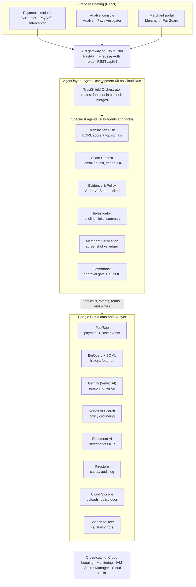

# Google Pay TrustShield

> **Prototype simulator — synthetic data.** Not affiliated with Google Pay. No real Google Pay data, identities or credentials are used anywhere in this repo.

Hackathon entry for the **Google Cloud AI Builder Cup, BFSI track** (submission 18 Oct 2026).

## The pitch

UPI scams increasingly pass PIN and device checks, because the victim approves the payment themselves — under manipulation ("your account will be blocked", fake KYC, fake refunds, "receive money first"). Fraud stacks score the transaction but rarely connect it to the message, call or QR code that induced it.

**TrustShield** is a multi-agent safety layer that catches *authorized payments made under manipulation*:

| Module | User | Job |
| --- | --- | --- |
| **PaySafe Interceptor** | Customer | Scores a payment → allow / warn / step-up / hold, and explains the top 3–5 signals in plain, non-accusatory language with a safe next action |
| **PayInvestigator** | Fraud analyst | Auto-creates a case when R ≥ 0.70: timeline, linked accounts, cited policy, grounded Q&A; a human approves every escalation |
| **PayGuard** | Merchant | Checks a payment screenshot against the ledger → verified / pending / inconsistent / suspicious |

Risk is fused as `R = sigmoid(w1·A + w2·B + w3·D + w4·L + w5·V + w6·S + w7·N)` (amount deviation, beneficiary risk, device, location, velocity, scam-context probability, mule-network risk). Full spec: [Google_Pay_TrustShield_PRD.md](Google_Pay_TrustShield_PRD.md).

## Architecture



The gateway calls `trustshield_agents.evaluate_payment(request)`; the agents return a decision with `top_signals` and `evidence_ids`; the gateway's **Governance** module checks it, assigns an `audit_id`, writes it to Firestore `audit_log` and responds.

## Repo layout and owners

| Path | What | Owner |
| --- | --- | --- |
| `web/` | React + Vite + TS. Routes `/pay`, `/analyst`, `/merchant` | Sameer |
| `services/gateway/` | FastAPI on Cloud Run. REST `/api/v1`, Governance, audit log | Hitesh |
| `services/agents/` | Google ADK orchestrator + Transaction Risk, Scam Context, Investigator, Evidence & Policy agents; risk engine; prompts | Jahnavi |
| `shared/contracts/` | Pydantic models = the API contract (source of truth); fixtures; `openapi.json` | Jahnavi (changes agreed by all) |
| `data/` | Synthetic data generator, BigQuery schemas + feature views | Ronak |
| `infra/` | Cloud Build, gcloud bootstrap scripts | Hitesh |
| `evals/` | Eval sets + runner | Jahnavi |

## Local setup (no GCP credentials needed)

Prerequisites: Python 3.11+, Node.js LTS (24), Java 21+ (Firestore/Pub/Sub emulators; firebase-tools 15 needs 21), Firebase CLI (`npm install -g firebase-tools`).

```bash
cp .env.example .env          # TRUSTSHIELD_MODE=mock by default
```

**Shared contracts**

```bash
cd shared/contracts
python3 -m venv .venv && source .venv/bin/activate
pip install --prefer-binary -r requirements.txt -e ".[openapi]"
pytest
python scripts/export_openapi.py   # writes shared/contracts/openapi.json
```

**Agents service**

```bash
cd services/agents
python3 -m venv .venv && source .venv/bin/activate
pip install --prefer-binary -r requirements.txt -e ../../shared/contracts -e .
pytest
python -m trustshield_agents.risk demo     # risk engine on the ₹85,000 fixture
python -m trustshield_agents.demo1         # full agent path, mock mode
adk web adk_apps                           # ADK dev UI
```

Integration snippet for the gateway: [services/agents/README.md](services/agents/README.md). Contract summary: [shared/contracts/CONTRACT.md](shared/contracts/CONTRACT.md).

**Firestore emulator** (for the gateway's audit log)

```bash
firebase emulators:start --only firestore
export FIRESTORE_EMULATOR_HOST=localhost:8080
```

**Evals**

```bash
cd services/agents && source .venv/bin/activate
python ../../evals/run_evals.py            # writes evals/results/<date>.md
```

Set `TRUSTSHIELD_MODE=gcp` (plus `GCP_PROJECT_ID`, `GCP_REGION`, `GEMINI_FAST_MODEL`, and `gcloud auth application-default login`) to use real Gemini on Vertex AI.

## Ground rules

- Synthetic data only.
- Customer-facing text is non-accusatory and always gives a safe next action. It never asks for a PIN, OTP, password or card number.
- Every policy claim cites a retrieved source; otherwise "not covered by policy".
- Hold / restrict / escalate always needs a human (analyst) approval record.
